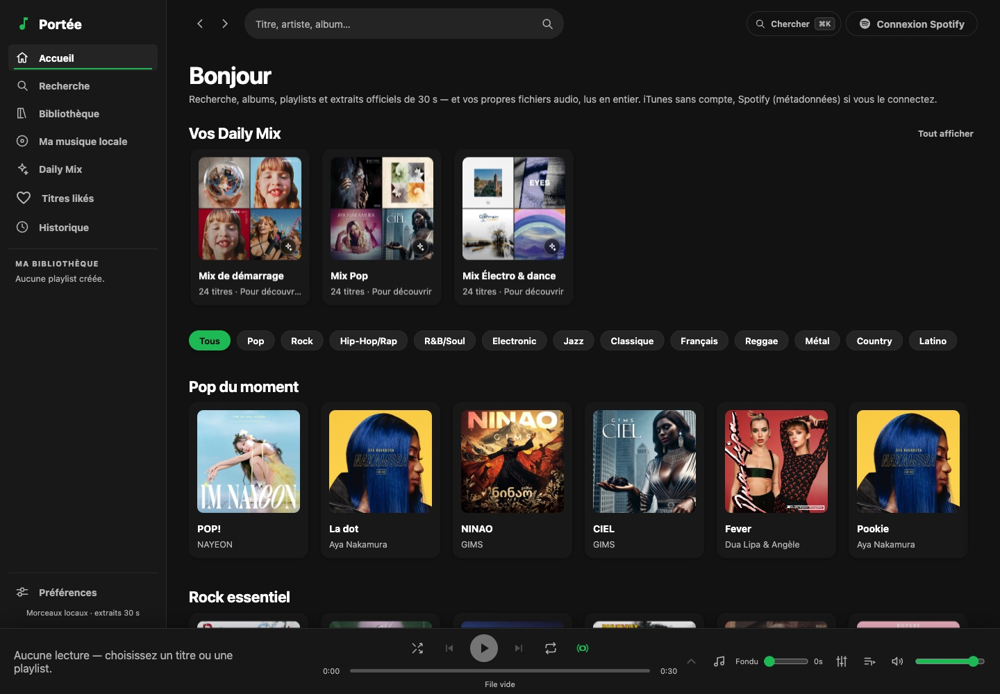
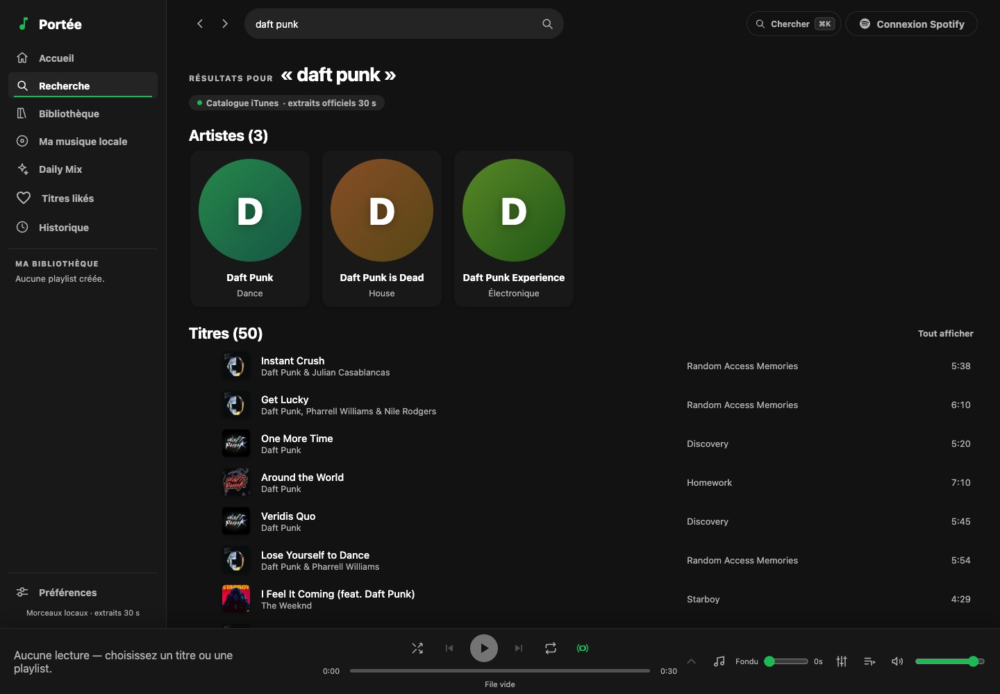
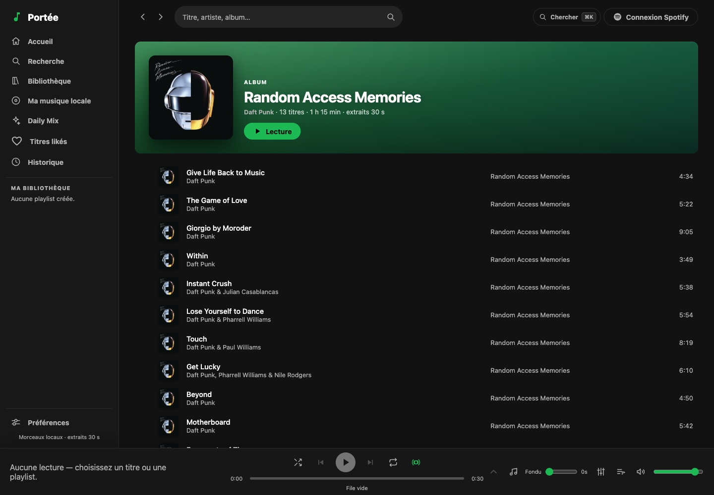
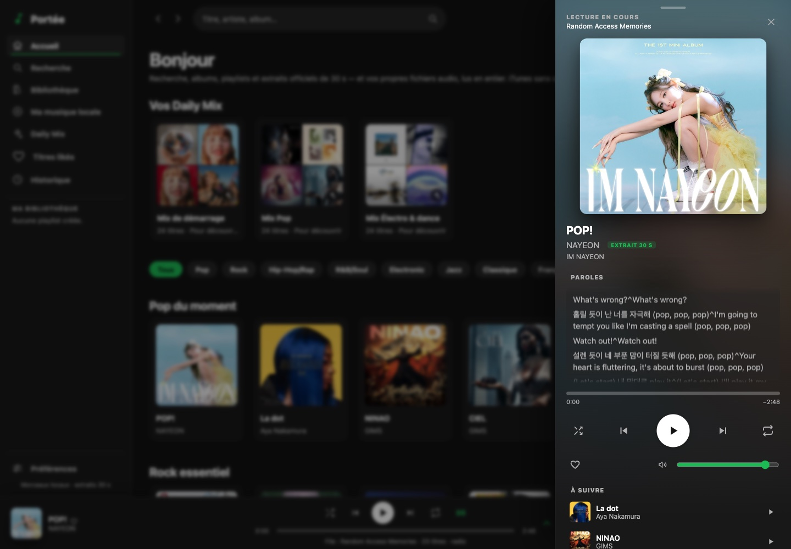
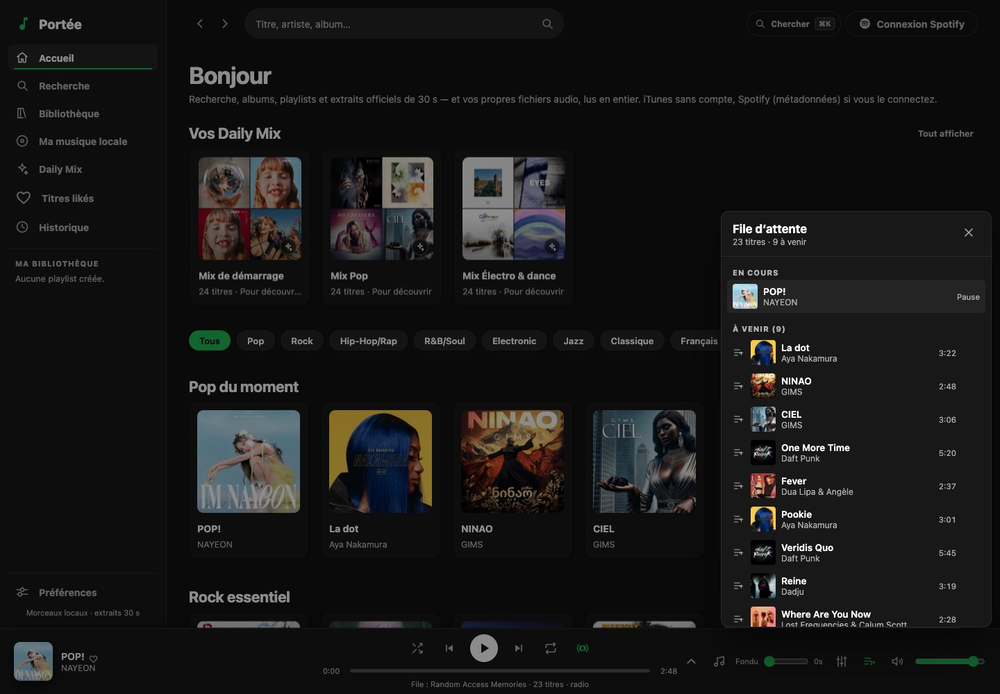
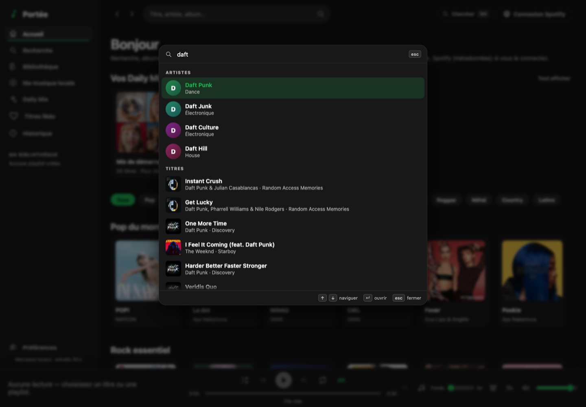
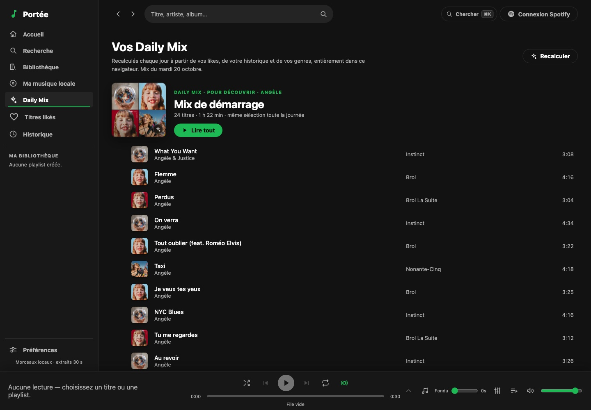
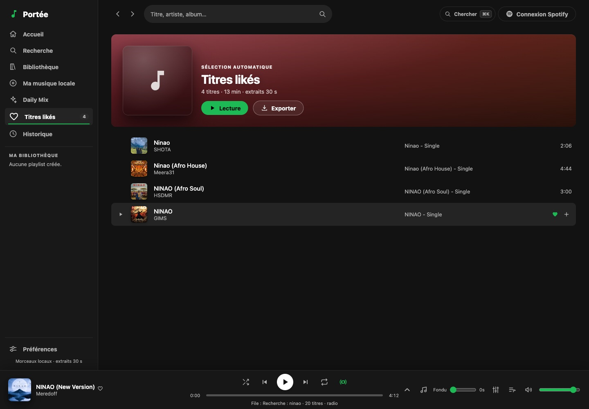
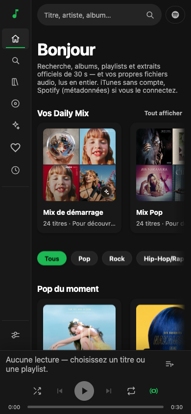
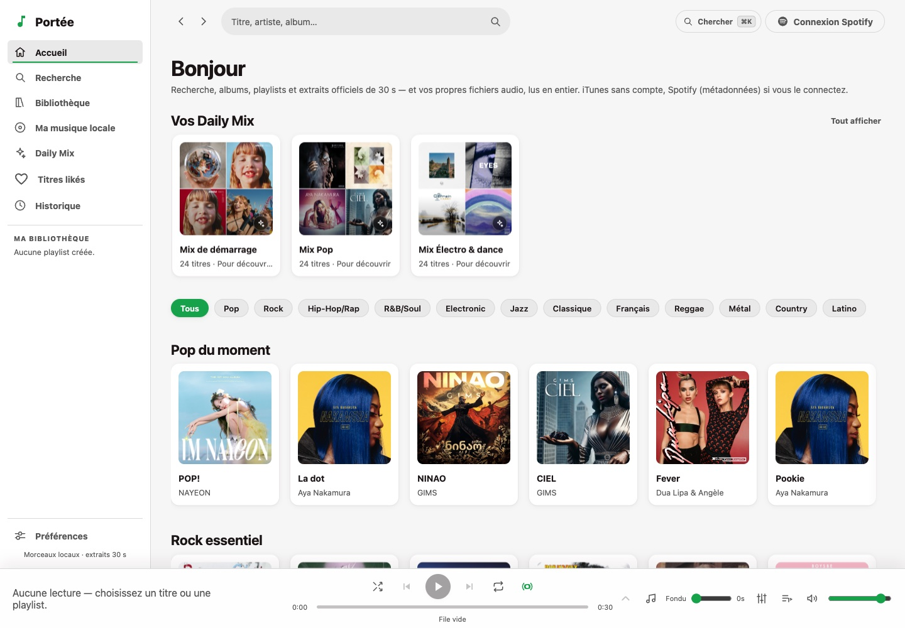

<div align="center">

# 🎵 Portée

**Un lecteur musical open source, complet et sans compte obligatoire — recherche, albums, artistes, playlists, file d'attente, paroles et extraits officiels. Aucune clé API.**

[](https://github.com/DmzGamingYT/spotifycraft/actions/workflows/ci.yml)
[](LICENSE)
[](https://react.dev)
[](https://www.typescriptlang.org)
[](https://vite.dev)
[](crates/import-core)


[Fonctionnalités](#-fonctionnalités) · [Aperçu](#-aperçu) · [Démarrage](#-démarrage-rapide) · [Architecture](#-architecture) · [Qualité](#-qualité--tests)



<sub>Accueil — Daily Mix personnalisés, filtres de genres et étagères du catalogue.</sub>

</div>

---

## ✨ Pourquoi Portée ?

Une interface de musique complète qui tourne **entièrement dans le navigateur** :

- **Aucune clé API** : le catalogue public iTunes fournit les métadonnées et les **extraits officiels de 30 s**.
- **Aucun compte local** : la connexion, optionnelle, passe par **Spotify OAuth PKCE** (sans secret) pour enrichir les métadonnées.
- **Vos fichiers, en entier** : glissez un dossier de MP3, FLAC, WAV, M4A, OGG ou OPUS — il est importé dans **IndexedDB** et lu sans serveur.
- **Vos données restent chez vous** : likes, playlists, historique et mix sont stockés localement, jamais envoyés.

> **Portée** est l'application musique de la collection **[Craftline](https://site-837caca50a67485a994f4549b9ef7404.freebuff.page/collection/)** —
> avec **Séquence** (vidéo) et **Battement** (santé). Même promesse : open source, sans abonnement, sans télémétrie.

## 🖼️ Aperçu

<table>
  <tr>
    <td width="50%">
      
      <sub><b>Recherche en direct</b> — titres, albums, artistes, durées toujours visibles et filtrage instantané.</sub>
    </td>
    <td width="50%">
      
      <sub><b>Albums</b> — pochette, artiste cliquable, pistes, lecture en une puce et badge « extraits 30 s ».</sub>
    </td>
  </tr>
  <tr>
    <td width="50%">
      
      <sub><b>Vue grand format</b> — pochette, halo flouté, paroles, progression, volume et « À suivre ».</sub>
    </td>
    <td width="50%">
      
      <sub><b>File d'attente</b> — glisser-déposer pour réordonner, retirer un titre, radio continue.</sub>
    </td>
  </tr>
  <tr>
    <td width="50%">
      
      <sub><b>Palette ⌘K</b> — tout chercher et tout lancer au clavier, sans quitter la page.</sub>
    </td>
    <td width="50%">
      
      <sub><b>Daily Mix</b> — sélections calculées localement à partir des likes, écoutes et genres.</sub>
    </td>
  </tr>
  <tr>
    <td width="50%">
      
      <sub><b>Titres likés</b> — sélection persistante, lecture en un clic et export M3U.</sub>
    </td>
    <td width="50%">
      
      <sub><b>Mobile</b> — colonne d'icônes, barre de lecture compacte et panneaux plein écran.</sub>
    </td>
  </tr>
</table>

<div align="center">
  
  <sub>Thème clair — l'application suit le système par défaut, ou se force en clair/sombre.</sub>
</div>

## 🚀 Fonctionnalités

| | |
| --- | --- |
| **Accueil** | Salutation dynamique, raccourcis de playlists, « Écoutés récemment », Daily Mix, chips de genres et étagères Pop / Rock / Hip-Hop / Électro / Jazz / Chanson française. |
| **Recherche** | Recherche **en direct** débouncée et annulable, titres + albums + artistes, badge de source, états vide/erreur/partiel distincts, URL propre. |
| **Lecture** | Lecture/pause, précédent/suivant, aléatoire, répétition, progression cliquable **et clavier**, volume, mute, fondu et **radio continue** en fin de file. |
| **File d'attente** | Panneau dédié, piste en cours, titres à venir, **glisser-déposer**, retrait, « Lire ensuite » depuis le menu d'une ligne. |
| **Vue grand format** | Panneau latéral avec pochette, halo flouté, paroles, progression écoulé/restant, volume, like, « À suivre ». Fermeture par Échap, fond, croix ou glissement. |
| **Paroles** | Paroles officielles **LRCLIB** (sans clé) : horodatées et surlignées pour les fichiers complets, texte simple pour les extraits de 30 s. |
| **Palette ⌘K** | Titres, albums, artistes, playlists, fichiers locaux et navigation ; filtrage instantané (accents/casse), flèches, Entrée, Échap. |
| **Playlists** | Création, renommage, suppression, ajout via ⊕, lecture en une puce, retrait d'un titre et **export M3U** (VLC, foobar2000…). |
| **Ma musique locale** | Glisser-déposer de fichiers **ou d'un dossier**, stockage IndexedDB, dédoublonnage, progression album par album, pochettes ID3/FLAC intégrées, lecture complète. |
| **Daily Mix** | Profil de goût local (likes, écoutes, playlists, artistes suivis), plan **stable pour la journée**, recalcul manuel. |
| **Bibliothèque** | Titres likés, historique réellement écouté, artistes suivis et playlists — le tout persisté en `localStorage`. |
| **Thème & accessibilité** | Thème système par défaut (ou clair/sombre), focus visible, pièges à focus, libellés ARIA, contrastes, `prefers-reduced-motion`, lien d'évitement. |
| **Lecteur avancé** | **Égaliseur 10 bandes** + presets, visualiseur audio, MediaSession (écran verrouillé, casque), raccourcis `Espace` `←/→` `Maj+←/→` `M` `S` `R`. |

## 🧩 La collection Craftline

| Application | Rôle | Dépôt |
| --- | --- | --- |
| **Séquence** | Client vidéo : recherche, lecteur, Shorts, abonnements. | [tubecraft](https://github.com/DmzGamingYT/tubecraft) |
| **Portée** | Lecteur musical : catalogue, extraits, paroles, fichiers locaux. | ce dépôt |
| **Battement** | Suivi sportif et santé local-first, coach IA. | [pulsecraft](https://github.com/DmzGamingYT/pulsecraft) |

## ⚡ Démarrage rapide

Prérequis : **Node.js ≥ 20.19** (ou ≥ 22.12 pour Vite 8).

```bash
git clone https://github.com/DmzGamingYT/spotifycraft.git
cd spotifycraft
npm ci
npm run dev        # http://127.0.0.1:5184
```

Sur macOS, vous pouvez aussi **double-cliquer sur `Démarrer Portée.command`**.

Le noyau d'import Rust est fourni **précompilé** (~45 Ko) dans `src/wasm/import-core` :
aucun outillage Rust n'est nécessaire pour lancer ou construire l'application.

### Connexion Spotify (optionnelle)

1. Créez une application sur <https://developer.spotify.com/dashboard>.
2. Déclarez l'URL de redirection exacte `http://127.0.0.1:5184/callback`
   (et `http://127.0.0.1:5185/callback` pour `npm run preview`).
3. Renseignez `VITE_SPOTIFY_CLIENT_ID` dans `.env`, puis relancez `npm run dev`.

Le flux est **Authorization Code + PKCE** : aucun `client_secret` côté navigateur,
`state` OAuth vérifié, scopes en lecture seule, jetons purgés à la déconnexion.
Sans identifiant, l'application reste pleinement utilisable avec le catalogue iTunes.

> **Extraits Spotify** — depuis fin 2024, Spotify ne garantit plus `preview_url` aux
> nouvelles applications. Portée garde Spotify pour les métadonnées et
> **complète les extraits manquants avec iTunes**. Si rien n'est trouvé, les titres
> iTunes prennent le relais pour que la lecture reste possible.

## 🎚️ Commandes

| Commande | Rôle |
| --- | --- |
| `npm run dev` | serveur de développement + proxies iTunes/Spotify |
| `npm run typecheck` | vérification TypeScript stricte |
| `npm test` | tests unitaires (Vitest), benchmark du noyau inclus |
| `npm run bench` | benchmark détaillé du noyau WASM (temps par fichier) |
| `npm run wasm:build` | reconstruit le paquet WASM + cachet d'intégrité |
| `npm run wasm:check` | échoue si le paquet WASM versionné est périmé |
| `npm run wasm:verify` | reconstruit avec wasm-pack puis compare au paquet versionné |
| `npm run build` | build de production dans `dist/` |
| `npm run preview` | sert `dist/` sur `:5185` (proxies actifs) |

## 🧱 Architecture

```
vite.config.ts                 Vite 8 + React + proxies
server/itunesProxy.ts          /it/api/search, /it/api/lookup (cache borné)
server/spotifyProxy.ts         /sp/api/* (Bearer utilisateur, cache borné, no-store)
crates/import-core/            Rust → WASM : ID3v2/ID3v1, APIC, FLAC/Vorbis, PICTURE
src/lib/audioCore.ts           chargement unique du WASM + repli JavaScript
src/wasm/import-core/          paquet WASM généré (versionné)
src/api/itunes.ts              client iTunes (proxy puis direct)
src/api/spotify.ts             client Web API Spotify
src/api/spotifyAuth.ts         PKCE, refresh token dédupliqué, state OAuth
src/api/search.ts              recherche unifiée + hybridation des extraits
src/api/lyrics.ts              paroles LRCLIB (fiche exacte puis recherche)
src/lib/dailyMix.ts            profil de goût, familles de genres, plan du jour
src/lib/localLibrary.ts        IndexedDB, import album par album, pochettes
src/lib/radio.ts               radio continue : clés de doublon, sélection
src/lib/equalizer.ts           presets et gains de l'égaliseur 10 bandes
src/store.ts                   état persistant (lecteur, likes, playlists…)
src/components/player/         AudioEngine, PlayerBar, QueuePanel, NowPlaying, EqPanel
src/pages/                     Accueil, Recherche, Bibliothèque, Local, Daily Mix,
                               Playlist, Album, Artiste, Historique, Callback
```

**Pourquoi un proxy ?** L'API iTunes ne renvoie pas d'en-têtes CORS fiables depuis
un navigateur, et le proxy Spotify évite d'exposer les appels tout en gardant un
cache court côté serveur. Pour un hébergement statique, exposez les mêmes routes
via un petit service (Cloudflare Worker, Netlify/Vercel function) — le front ne change pas.

## 🧪 Qualité & tests

- **CI GitHub Actions** : jobs `rust` (compilation wasm + `cargo test`), `wasm`
  (reconstruction + comparaison au paquet versionné) et `app` (`npm ci` +
  `npm run check` : typecheck, 159 tests, build).
- **Benchmark** : le vrai `.wasm` est chargé et l'import doit rester sous
  0,02 ms (petit tag) / 0,05 ms (tag de 120 Ko), 100 ms pour 300 fichiers, et
  au moins **20× plus rapide** que le repli JavaScript.
- **Tests unitaires** : file de lecture, rapprochement d'extraits, formats, tags
  ID3, diversification, Daily Mix, radio, paroles, palette, égaliseur, M3U.
- **Accessibilité** : audit axe-core sans violation sur les écrans principaux
  (accueil, recherche, bibliothèque, local, mobile, lecture, file, palette).
- Caches mémoire bornés, réponses personnelles en `Cache-Control: no-store`,
  `ErrorBoundary` global, `prefers-reduced-motion` respecté.

## ⚠️ Limites connues

- Le catalogue en ligne reste limité aux **extraits officiels ~30 s** ; les
  fichiers importés sont lus en entier.
- Les pochettes intégrées sont extraites pour **MP3 (ID3v2 APIC)** et
  **FLAC (PICTURE)** ; M4A, OGG/OPUS et WAV gardent le visuel généré.
- IndexedDB est propre au navigateur et au profil : pas de synchronisation entre
  appareils, et les fichiers peuvent être évincés si le quota est atteint.
- Les jetons Spotify sont conservés en `localStorage` (standard SPA PKCE) :
  une faille XSS les exposerait. Les scopes sont en lecture seule.
- Projet indépendant, non affilié à Spotify / Apple. Les marques appartiennent à
  leurs propriétaires.

## 📄 Licence

Portée est publié sous licence [MIT](LICENSE) — libre à chacun d'utiliser,
modifier et redistribuer.

<div align="center">
  <sub>Captures réalisées avec les données réelles du catalogue iTunes. Bonne écoute 🎶</sub>
</div>
